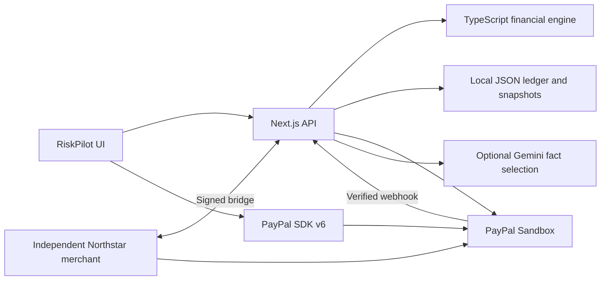

# RiskPilot Checkout

**See what a PayPal purchase changes before you pay. Save the resulting forecast from one verified capture.**

RiskPilot is a grounded-AI financial checkpoint inside a PayPal checkout. It verifies the merchant amount, recalculates cash-buffer and goal impact, explains only deterministic engine facts, and links one verified Sandbox capture to one saved forecast. Supporting Dashboard, Goals, Shop, Money, spending insights and Financial Profile pages use fictional finances; no live bank is connected and no real money moves.

## Built on Sheryl’s MVP

Sheryl’s baseline [`3d1543e`](https://github.com/SuyaYang/RiskPilot/commit/3d1543e) established the financial engine, core pages, PayPal Sandbox checkout/recovery and the integrated Northstar merchant flow. Cynthia’s follow-up builds on that implementation rather than replacing it.

| Area | Baseline | Added or refined |
| --- | --- | --- |
| Financial experience | Cash flow, cash buffer, goals, investment capacity | Compact mobile UI, clearer risk conclusions, income-date What-if and before/after purchase comparisons |
| Purchases | Server-priced Sandbox orders, signed merchant handoff, capture and recovery | Separate Shop and merchant experiences, verified reassessment, payment/forecast/funding status, duplicate-capture and reset protection |
| Spending | Manual financial fixtures and schedules | Deterministic fictional transaction history, monthly/category insights and recurring-pattern confirmation/edit/rejection |
| AI | Engine-grounded explanation and goal drafting | Simplified Financial Profile, fact sources, planning preferences and personalized purchase explanations with labeled fallback |
| Demo accounts | Fictional personas | One fixed financial profile per demo account; no in-account persona switch or subscription tiers |
| Demo reliability | Local startup and payment tests | Responsive checks, failure/recovery tests, repeat merchant sessions that preserve payment records, and deployment preparation |

See [PR #1](https://github.com/SuyaYang/RiskPilot/pull/1) for attribution and the complete change summary. The [original architecture roadmap](docs/ARCHITECTURE_ROADMAP.md) is retained as a historical proposal; its planned services are not all implemented.

## Two complementary purchase flows

### Explore in RiskPilot, then optionally buy

**Shop → Explore purchase impact → compare scenarios → PayPal Checkout → final Pay Now in PayPal → verified capture → saved forecast and success page.**

- Exploration needs no PayPal authorization and creates no payment or order.
- The assessment starts with the current full-price purchase. Engine suggestions, scenario comparisons and income-date What-if remain available. Choosing no purchase or a future-date preview does not submit payment.
- A single **PayPal Checkout** button appears directly below the essential risk conclusion, with no expandable checkout section.
- New Shop orders use PayPal `PAY_NOW` and SDK `commit:true`: the buyer explicitly confirms payment in PayPal. There is no repeated Quick Review when the trusted assessment is unchanged.
- Before capture, the server checks the original assessment and current financial facts. Changed, expired or unverifiable assessments pause for review; uncertain outcomes use recovery on the same order. Legacy Continue orders retain their original review confirmation.
- Verified capture saves the conservative purchase reserve and forecast once. Merely returning from PayPal is not evidence that capture succeeded.

### Buy directly from an integrated merchant

**Northstar → merchant-priced PayPal order → buyer approval → automatic signed RiskPilot review → explicit Confirm and pay → verified capture → updated forecast → merchant receipt.**

- Start at **Northstar Electronics**, the independent demo storefront. A prior Shop visit or Explore step is not required.
- This path retains `CONTINUE` / SDK `commit:false`. Buyer approval does **not** capture payment; the buyer confirms in RiskPilot afterward.
- The signed, expiring handoff binds the server-verified order to the current fictional workspace. The merchant retains its own PayPal credentials and captures through the signed server-to-server bridge.
- Amount, cash-buffer risk, late-income stress and goal impact remain visible first. Full analysis starts collapsed: checkout sits horizontally below it; expanding restores desktop analysis/checkout columns.
- **Skip and enter RiskPilot** skips payment and opens Dashboard. The separate **Cancel and back to store** link returns to Northstar. PayPal cancellation and uncertain payments have their own status/recovery paths.
- Northstar must explicitly integrate RiskPilot. This does not intercept arbitrary third-party PayPal transactions; no browser extension is required.

Both paths use the same financial engine, provider-order verification, stable capture keys and exactly-once forecast saving. Comparison scenarios never select a real PayPal loan or change its terms.

[Detailed purchase experience](docs/FINAL_PURCHASE_EXPERIENCE.md) · [Merchant walkthrough](docs/MERCHANT_CHECKOUT.md)

## Run the local demo

Requires **Node.js 22**, npm, `curl`, and **Python 3**. The launcher uses curl for HTTP checks and Python 3 to validate JSON responses.

```bash
npm ci
cp .env.example .env
# Configure your own Sandbox credentials in .env, then:
npm run demo
```

| Entry | Local URL |
| --- | --- |
| Northstar external merchant | http://localhost:3200 |
| RiskPilot Dashboard | http://localhost:3100 |
| Proactive purchase exploration | http://localhost:3100/shop |
| Fixed fictional account sign-in | http://localhost:3100/login |

The launcher starts/checks both services and opens Northstar. Keep its terminal running; Ctrl+C stops only processes it started. Both services must run from the same working copy with matching bridge configuration.

```bash
npm run demo -- --check     # Read-only readiness check
npm run demo -- --no-open   # Start/check without opening a browser
npm run demo:shop           # Open the Shop entry instead
```

For RiskPilot alone, `npm run dev` defaults to port 3000; set `APP_ORIGIN` to its exact URL. The demo launcher configures port 3100. Restart services after editing environment values.

### Configuration

Use [.env.example](.env.example); never commit keys or payment ledgers.

| Setting | Purpose |
| --- | --- |
| `PAYPAL_CLIENT_ID`, `PAYPAL_CLIENT_SECRET` | Sandbox server credentials; required for actual Sandbox checkout |
| `NEXT_PUBLIC_PAYPAL_CLIENT_ID` | Optional browser override; must match the server’s Sandbox app |
| `PAYPAL_API_BASE` | Sandbox only: `https://api-m.sandbox.paypal.com`; live endpoints are rejected |
| `PAYPAL_WEBHOOK_ID` | Registered listener ID for verified PayPal webhook delivery |
| `APP_ORIGIN`, `RISKPILOT_ORIGIN`, `MERCHANT_ORIGIN` | Exact application/merchant URLs; launcher uses 3100/3200 locally |
| `MERCHANT_BRIDGE_SECRET` | Shared server-only key; local demo generates a key if blank |
| `STORE_PATH`, `MERCHANT_STORE_PATH` | Separate persistent RiskPilot and merchant JSON ledgers |
| `DEMO_SEED_ENABLED=true`, `DEMO_TODAY=2026-11-12` | Reproducible fictional fixtures and an optional fixed scenario date |
| `FINANCIAL_TIMEZONE` | Financial calendar timezone; defaults to `America/New_York`. `DEMO_TODAY` overrides the clock; payment timestamps remain actual UTC instants |
| `GEMINI_API_KEY`, `GEMINI_MODEL` | Optional AI; unavailable/invalid results fall back to labeled deterministic facts |

Without PayPal credentials, supported local simulation is explicitly labeled; it is not a verified Sandbox payment. No Plaid, Supabase or Python service setup is required for the current demo.

Demo accounts include `alex@riskpilot.demo`, `sam@riskpilot.demo` and `jordan@riskpilot.demo`. Each has one fixed fictional financial situation, isolated by browser workspace; these are not real inboxes or production authentication. PayPal’s Sandbox buyer login is separate.

## Current implementation



- **Finance:** the engine computes forecasts, risk, goal effects and educational investment capacity. AI cannot change authoritative figures or submit payments. Invest does not place trades.
- **Spending:** deterministic fictional histories power trends, categories and recurring detection. Confirm/edit/reject saves informational patterns; it does not automatically add a bill or double-count an existing obligation. [Feature guide](docs/SPENDING_INTELLIGENCE.md).
- **Money planning:** explicitly mapped, confirmed income feeds the shared 45-day forecast on expected dates, with conservative stress treatment. Alex supports explicitly applied, category-aware fictional spending budgets; drafts and unresolved categories retain their baseline. [Coverage and timing](docs/CATEGORY_SPENDING_MODEL.md). The three-month overview remains informational; `/invest` redirects to `/money`. [What-if preview and grounded explanations](docs/MONEY_WHAT_IF.md) · [Integration audit and safety rules](docs/FORECAST_INTEGRATION.md) · [Income planning](docs/MONEY_PLANNING.md) · [Budgets](docs/SPENDING_BUDGETS.md).
- **Financial Profile:** summaries and personalized purchase explanations use available server facts and confirmed preferences. Sources and uncertainty remain inspectable; preferences do not overwrite financial calculations.
- **Payments:** ownership, frozen product/amount/currency, approval and capture results are checked on the server. Pending/unknown/local-save-failure states retain same-order recovery. Merchant capture does not identify a consumer funding account or confirm an installment schedule.
- **Demo data:** reset is for disposable fictional state. Verified/uncertain payment records are protected. Northstar’s **Start another demo checkout** rotates a completed merchant session only after verification and preserves earlier records.

Actual code lives in `app/`, `lib/`, `merchant-demo/` and `tests/`. Development uses `.next-dev` so production builds do not overwrite running development chunks.

## Validation and remaining work

```bash
npm run typecheck
npm test
npm run build
```

Current validation has **313 automated tests passing**, with type checking and the production build passing. Tests cover financial calculations, isolation, merchant handoff, Shop direct capture, stale assessments, missing approval, legacy orders, payment recovery, provider-error parsing, grounded-AI retry behavior and duplicate capture/forecast prevention. GitHub Actions runs these checks on pushes and pull requests.

Browser checks cover desktop/mobile layouts, default collapsed review, Skip navigation and the single visible Shop PayPal button. These responsive viewport checks are not physical iOS/Android acceptance.

Step 7B completed new actual Sandbox transactions for **both** purchase journeys, with product-owner
participation: Northstar $900 and Shop $249. Provider capture status, receipts/success pages and
exactly one reserve/saved forecast per payment were verified. Failure/recovery and duplicate-confirm
scenarios additionally use controlled mocks; responsive browser checks are not physical-device acceptance.
See [the final acceptance evidence and limits](docs/STEP7B_ACCEPTANCE.md) and [the 2:50 demo rehearsal](docs/STEP7B_DEMO_REHEARSAL.md).

Before the final demonstration:

- [x] Complete live Sandbox Shop Pay Now → verified capture → saved forecast acceptance.
- [x] Complete live Northstar review/confirm → verified capture → merchant receipt acceptance.
- [x] Verify skip/future/cancellation navigation and controlled failure/idempotency/recovery regressions.
- [ ] Verify PayPal popup/redirect behavior on physical mobile devices.
- [ ] Configure and validate public HTTPS hosting, callback origins, persistent ledgers and webhook delivery if an external demo URL is required.

**Not implemented:** Plaid connection/bank reconciliation, Supabase Auth/RLS/Postgres, a Python engine service/background worker, production identity or multi-instance storage, actual Pay Later eligibility/loan schedules, and live-money payments. Historical spending is fictional rather than fetched from a bank. Only cooperating Northstar is integrated.

The repository includes [Render deployment preparation](render.yaml) and [deployment instructions](docs/DEPLOYMENT.md), but no public deployment was created or accepted in this work. `autoDeploy` is disabled. CI success and Git push do not publish the demo or update an existing external service.

Existing Sandbox purchases remain in the forecast and may leave even the no-purchase baseline below the buffer. Preserve these records; do not change risk calculations to make a demo green.

## Future vision showcase

Open [the standalone `/vision` page](http://localhost:3100/vision) with the local demo running
(or append `/vision` to your app URL). It is a static, presentation-ready closing frame for the
hackathon video: a future PayPal ecosystem concept, **not an official PayPal interface or existing
native integration**. Figures are labeled illustrative demo values, not live account data.
The actual implemented payment experience remains the merchant-integrated PayPal Sandbox prototype
and the separate Shop Sandbox checkout described above. Vision is intentionally outside the primary navigation.

## Documentation

- [Running, reset and recovery](RUNNING.md)
- [Final purchase experience and implementation notes](docs/FINAL_PURCHASE_EXPERIENCE.md)
- [Merchant integration](docs/MERCHANT_CHECKOUT.md)
- [Spending Intelligence](docs/SPENDING_INTELLIGENCE.md)
- [Implementation and acceptance gaps](docs/IMPLEMENTATION_STATUS.md)
- [Original architecture roadmap — planned, not current runtime](docs/ARCHITECTURE_ROADMAP.md)
- [Historical update record](docs/CHANGELOG_2026-11-10.md)

Earlier phase documents record their validation at that time. The two flows above describe the current product behavior.

## Final corrective audit and code freeze

[Step 8.6 result](docs/STEP86_RESULT.md) is the current financial consistency and verification record.
[Step 8.5](docs/STEP85_RESULT.md) remains historical security/remediation evidence.
Earlier acceptance reports are historical evidence, including the two verified Sandbox captures;
they do not establish live acceptance of later code changes. Automated mocks do not prove complete
financial correctness or a new live payment. No new actual payment was initiated during remediation.

Use [the authoritative three-minute rehearsal](docs/STEP7B_DEMO_REHEARSAL.md), including `/vision`.
Equivalent established biweekly replacements retain capped stress/goal income and span existing
installment evaluations; additional plans remain conservative. A daily-budget equivalent is a no-op;
a different amount explicitly converts to a calendar-month budget. Verified refunds/reversals change
status, while their original reserve remains until financial reconciliation is implemented.

Only timing-compatible biweekly replacements with the same next effective receipt become authoritative.
Shifted dates, monthly/biweekly conversions and one-time replacements remain Needs review; the original
modeled salary remains active, and the proposed change is not reflected as an income loss or new cash.
Compatible lower amounts reduce established assumptions; higher amounts retain existing caps.
Additional income keeps its existing explicit mapping and conservative treatment.

Immediate full-price purchase previews and completed reserves now use the same effective financial
state through `projectGoals`: today's cost reduces projected starting cash once, future payments
consume future contribution buckets, and independent buffer pressure remains protected. No predicted
dates are copied into goals. On clean Alex, November 12, a $900 purchase retains Japan Trip's March 14
and Emergency Fund's April 13 estimates in both paths while reducing this month's total goal allocation
$642 → $462 and capacity $90 → $0. The cash minimum still falls $1,720 → $820. These estimates do not
make a buffer-breaching purchase safe. Installment/future-date schedules are different economic inputs.
