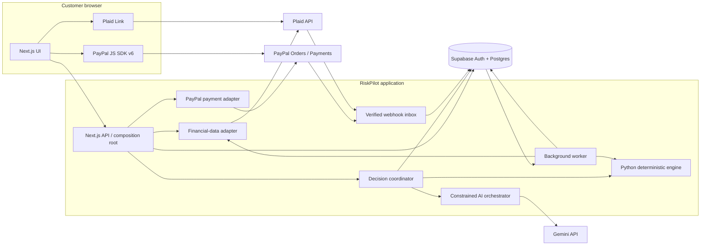

# RiskPilot Checkout

**Understand the cost of a purchase before committing to it.** RiskPilot compares a cart against upcoming bills, cash reserves, and savings goals, then lets the customer complete their chosen purchase through PayPal Checkout. A verified payment updates the forecast; subsequent bank activity is reconciled without counting the same expense twice.

> **Project status — architecture specification.** This directory currently contains design documents, not a runnable application. The service boundaries, endpoints, repository layout, and acceptance tests below are implementation contracts. Commands and hosted demo links should be added only after they work. The intended hackathon integration uses PayPal Sandbox and Plaid Sandbox; it does not move real money.

The initial product is a US, USD, consumer-facing web app with its own small demo store and one sandbox merchant. It does not claim to embed in arbitrary merchants' checkouts. Investment features show cash capacity and educational scenarios; they do not place trades or select securities.

## What the customer sees

1. Connect a test bank account through Plaid Link or enter a financial profile manually.
2. Add goals such as an emergency reserve or a trip, including amount, deadline, and priority.
3. Select an item in the demo store. Compare paying in full, hypothetical Pay Later schedules, a genuinely cheaper catalog item, and waiting.
4. See the lowest projected balance, bills that drive the risk, and each goal's revised completion date. The financial engine computes these values; AI translates the trade-offs into plain language.
5. Choose an option and approve the full cart amount in PayPal. After the server verifies capture, RiskPilot updates its own projected cash flow. Later Plaid transactions reconcile against that projection.

Pay Later availability in the SDK, approval by PayPal, and the customer's actual loan terms are distinct facts. RiskPilot's pre-checkout installment schedules are labeled **scenarios**, never offers or guarantees. PayPal pays the merchant for the full purchase amount; a $900 item creates a $900 order whether the customer ultimately pays immediately or finances it. [PayPal Pay Later overview](https://developer.paypal.com/pay-later/overview)

## Architecture at a glance



The Next.js backend owns authentication, request validation, user authorization, orchestration, and server-side provider credentials. Its financial-data, decision, AI, and payment adapters are modules within one deployable service, not four independent microservices. The separate Python service owns pure financial calculations and has no provider credentials or database write access. A worker handles asynchronous provider events, transaction sync, reconciliation, forecast publication, and reminders. Postgres is the durable record for commands, provider facts, inputs, results, and background jobs.

| Boundary | Owner and contract | Failure behavior |
|---|---|---|
| Browser → API | Authenticated, validated commands; the server derives `user_id` from the session | Reject stale versions and cross-user IDs before external calls |
| API/worker → financial engine | Versioned, immutable JSON input; amount in integer minor units; result includes input and policy versions | Preserve the last valid result and show its timestamp; never invent new numbers |
| API → PayPal | Server-priced cart and a checkout session bound to an approved decision | Unknown create/capture result enters reconciliation; no blind second charge |
| Provider → webhook inbox | Raw payload verified, deduplicated, then durably persisted | Acknowledge only after persistence; retry work from the inbox |
| AI → tools | Explicit allowlist with schemas and user-scoped read access | Use deterministic explanation templates if AI fails or contradicts engine facts |

## Repository layout

The proposed monorepo keeps the deployment units and shared contracts visible:

```text
apps/
  web/                 Next.js pages, authenticated API, provider adapters
  worker/              durable jobs, provider sync, reconciliation, alerts
services/
  engine/              Python cash-flow and goal-allocation kernel; HTTP wrapper
packages/
  contracts/           versioned JSON Schema/OpenAPI; generated TS/Python types
  domain/              money, dates, states, canonical input hashing
supabase/
  migrations/          tables, constraints, RLS, indexes
fixtures/              three resettable financial profiles and store catalog
tests/                 financial invariants and payment failure scenarios
docs/                  architecture decisions, API contract, demo guide
render.yaml            environment-specific deployment declaration
.env.example           variable names only; no credentials
LICENSE
README.md
```

This structure is a target, not a claim that the listed directories already exist. Prefer one TypeScript application plus one worker and one Python service for the hackathon. Do not add a queue broker until Postgres-backed jobs prove insufficient.

## Core domain model

The system tracks three separate realities:

| Reality | Examples | Rule |
|---|---|---|
| Observed | Plaid account balance, posted transaction, confirmed goal balance | Preserve source and `observed_at`; never overwrite with a projection |
| Committed | PayPal capture, customer-confirmed funding source, future bill or installment | Count each economic obligation once, even if provider events repeat |
| Predicted | Daily balances, stress scenarios, goal delay, allocatable cash | Derive from a versioned snapshot; recompute when inputs change |

Core tables: `profiles`, `plaid_items`, `accounts`, `balance_snapshots`, `transactions`, `scheduled_events`, `goals`, `goal_versions`, `products`, `carts`, `financial_snapshots`, `forecasts`, `decisions`, `decision_options`, `checkout_sessions`, `order_commands`, `orders`, `captures`, `webhook_inbox`, `cashflow_commitments`, `installment_plans`, `reconciliation_links`, `jobs`, `outbox_events`, `explanations`, `notifications`, and `audit_log`.

Important uniqueness and version rules:

- Provider item, transaction, PayPal order, capture, and webhook event identifiers have unique constraints within their provider/account scope.
- Each checkout session fixes the user, cart version, price, currency, financial snapshot, goal version, decision, and selected option. A stale decision requires a new assessment.
- An idempotency key is scoped to one operation and one request hash. Reusing the key with different content is a conflict.
- Payment facts and their recomputation job are committed in one database transaction. A worker may retry, but an older forecast may not replace a newer version.
- Goal reserves are virtual earmarks unless an actual transfer occurred. Releasing a reserve when paying for the goal prevents double subtraction.

## Purchase and payment sequence

```mermaid
sequenceDiagram
  actor Customer
  participant Web as Web/API
  participant Engine as Financial engine
  participant DB as Postgres
  participant PayPal
  participant Worker
  participant Plaid