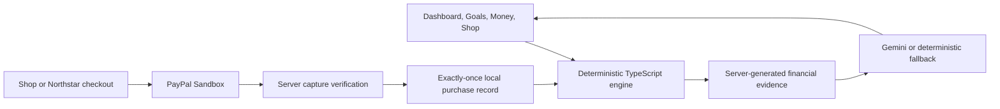

# RiskPilot

**Financial intelligence at the moment of PayPal payment.**

RiskPilot connects planning with checkout: understand your finances, explore what a purchase could change, and see your updated outlook after a verified PayPal Sandbox capture.

## The problem

Checkout tells us the price. It rarely tells us whether upcoming bills, a delayed paycheck, an emergency reserve or an important savings goal make that purchase difficult. RiskPilot brings that context to the decision, while the user remains in control of whether to pay.

## What you can do

- **Dashboard:** inspect a fictional financial snapshot, 45-day cash-flow forecast, upcoming income/bills, protected cash buffer, available-to-allocate capacity and historical spending insights.
- **Goals:** set savings priorities and review dynamic contributions, completion estimates and purchase-related changes.
- **Money:** explore spending history, category suggestions and budget What-if previews; explicitly apply supported category replacements. Plan monthly, biweekly, quarterly or one-time income where supported. Additional planned income is treated conservatively. Only timing-compatible income replacements become authoritative; unsupported date/cadence changes remain planning-only, with original modeled salary active.
- **Shop:** explore a purchase without creating a payment; compare buying now, after expected income, waiting and educational Pay in 4 / Pay Monthly scenarios. Installment scenarios are simulations, not approved or enabled financing. Actual checkout captures the full price.
- **Grounded explanations:** ask about engine-calculated financial facts, inspect sources and use confirmed explanation preferences.
- **Vision:** open `/vision`, a standalone concept for a possible deeper PayPal experience. It is not an official PayPal interface or a current native integration.

## PayPal is part of the decision journey

### A. Explore in RiskPilot Shop, then buy

**Shop → payment-free impact analysis → PayPal Checkout (`PAY_NOW`, `commit:true`) → final buyer confirmation in PayPal → server-verified capture → saved forecast.**

An unchanged, current assessment does not require another mandatory RiskPilot confirmation after PayPal's final Pay Now. Changed or expired assessments pause for review; uncertain outcomes use recovery on the same order.

### B. Start at the independent Northstar merchant

**Northstar → server-priced PayPal order → buyer approval (`CONTINUE`, `commit:false`) → signed RiskPilot impact review → explicit Confirm and Pay → verified capture → updated outlook → merchant receipt.**

Approval alone does not capture this merchant order. The review gives the buyer financial context before the final payment action.

Both paths validate order ownership, current financial inputs, assessment expiry, amount and USD currency. Server-owned checkout intent determines the confirmation path; signed merchant handoffs protect the connection between store and review. Stable capture identifiers and recovery record one economic purchase and one saved forecast. These are local prototype safeguards, not production identity or complete payment infrastructure. [Purchase flows](docs/PURCHASE_FLOWS.md) · [Merchant integration](docs/MERCHANT_CHECKOUT.md)

## How the AI works

**Deterministic engine for financial truth. Generative AI for personalized understanding.**

The TypeScript engine calculates balances, income/expenses, cash-buffer risk, allocation capacity, goal contributions and dates, purchase timing and educational installment comparisons. Gemini receives server-generated evidence to select and organize explanations. In purchase and Money reviews, the model orders approved fact IDs; the application renders server-authored statements. Other explanation paths validate output against engine evidence. Optional goal drafts require user confirmation.

Gemini does not set authoritative balances, determine payment amounts, authorize payments or execute purchases. Missing credentials, provider errors or invalid responses produce labeled deterministic fallback explanations.

## Financial intelligence engine

The dashboard displays 45 daily balances and a seven-day income-delay stress check. Longer payment schedules extend existing affordability evaluation through their final payment, while the chart stays 45 days. Goal estimates use priority-based contributions and 30.4-day monthly funding buckets.

Immediate purchases reduce projected starting cash once. Future and hypothetical installment payments consume safe existing cash headroom once in date order, then reduce contributions only for uncovered costs. Headroom is evaluated through the payment horizon, capped by current cash and conservative income assumptions. Independent deficits and protected-goal priorities remain intact. Equivalent immediate previews and completed reserves agree under unchanged assumptions. [Current financial contract](docs/FORECAST_INTEGRATION.md) · [Step 8.7 results](docs/STEP87_RESULT.md)

## Example: fictional Alex, November 12, 2026

Alex starts with **$3,500 checking cash**, a **$1,720** minimum forecast, **$1,540** delayed-income minimum and **$90** available to allocate.

Explicitly applying Shopping **$90 → $30/month** changes the minimum to **$1,738**, delayed-income minimum to **$1,572** and allocation capacity to **$122**, without increasing checking cash.

From that **shopping-adjusted** workspace, a $900 laptop gives:

| Scenario | Lowest cash | Delayed-income minimum | Risk |
| --- | ---: | ---: | --- |
| Buy today | $838 | $672 | Red |
| Buy after payday (Nov 22) | $1,334.54 | $672 | Yellow |
| Hypothetical Pay in 4 | $1,513 | $1,122 | Green |
| Hypothetical Pay Monthly | $1,738 | $1,572 | Green |

Pay Monthly includes $100.44 modeled financing cost; neither installment comparison establishes eligibility or actual terms. Green describes the modeled buffer checks, not guaranteed affordability.

For the immediate full-price purchase, projected starting cash becomes **$2,600** and available to allocate becomes **$0**. Japan Trip stays **March 14, 2027**, Emergency Fund stays **April 13**, and Start investing moves **March 14 → April 13**. An equivalent verified full-price capture produces matching forecasts and goal projections. These are fictional scenario results, not real customer outcomes.

## Technical architecture

**Next.js 15.5.29 · React 19.1.1 · TypeScript 5.8.3 · Google Gemini API · PayPal JavaScript SDK and Orders v2 API · local JSON demo persistence.** The independent merchant uses Node.js HTTP; tests use `node:test` with `tsx`.



There is no connected bank feed, Python forecasting service or Supabase database in the running prototype. [Implementation details](docs/IMPLEMENTATION_STATUS.md)

## Getting started

Requires **Node.js 22**, npm, `curl` and Python 3. Repository access is required while the team repository remains private.

```bash
git clone https://github.com/SuyaYang/RiskPilot.git
cd RiskPilot
git switch cynthia
npm ci
cp .env.example .env
```

For financial analysis without provider credentials:

```bash
DEMO_TODAY=2026-11-12 npm run dev
```

Open [RiskPilot](http://localhost:3000), sign in as `alex@riskpilot.demo` and use a fresh browser profile for an isolated demo workspace. Do not enter personal financial information. Gemini is optional; explanations fall back to deterministic facts.

For both Sandbox sites, configure your own matching PayPal browser/server credentials in ignored `.env`, then run:

```bash
DEMO_TODAY=2026-11-12 npm run demo
```

RiskPilot: [localhost:3100](http://localhost:3100) · Northstar: [localhost:3200](http://localhost:3200) · [Vision](http://localhost:3100/vision). The launcher checks configuration and starts services; it never pays or resets records. [Full setup, isolation and troubleshooting](RUNNING.md)

## Demo and validation

Use the [authoritative rehearsal](docs/STEP7B_DEMO_REHEARSAL.md) and [teammate acceptance checklist](docs/TEAM_ACCEPTANCE_REVIEW.md). [Submission text](docs/DEVPOST_SUBMISSION.md) is prepared; a final video link is not yet available. No public deployment is claimed.

```bash
npm test
npm run typecheck
npm run build
git diff --check
```

- Approved implementation freeze: `77730d2cbe8c60c4a9796322b355e6f9a5e8500e`; **324 passing tests**, TypeScript and production build passed. Clean `npm ci` and the same checks were repeated in an isolated copy for release preparation.
- Financial reference scenarios were independently reproduced. The owner reports a final independent Claude **GO** audit for Step 9.
- Historical provider-confirmed Sandbox captures: **$900 Northstar** and **$249 RiskPilot Shop**. These were test-environment payments, not production money. Their [sanitized acceptance record](docs/STEP7B_ACCEPTANCE.md) predates Step 8.7; final regressions used deterministic probes and mocked payment services, with no new actual capture.

Passing tests establish evidence for covered cases, not complete financial correctness.

## Current scope and limitations

This is a fictional-data, local, single-instance prototype. Workspace cookies and demo accounts are not production authentication. JSON storage is not a replicated financial ledger. No bank reconciliation, full refund accounting, trading or real installment product is implemented. Public HTTPS/webhook delivery and physical-device payment acceptance remain unverified. Known dependency advisories are documented in [Step 8.5](docs/STEP85_RESULT.md); no dependency migration is included in this frozen release. Financial estimates are not professional advice or guarantees.

## Future vision

RiskPilot could bring planning closer to payment through permissioned financial data, production identity, reconciliation and deeper PayPal ecosystem integration, subject to platform capabilities and permissions. `/vision` illustrates that opportunity. Whether this improves trust, repeat engagement or checkout decisions is a hypothesis to test.

## Team and license

Built by the RiskPilot team. Sheryl's [baseline MVP](https://github.com/SuyaYang/RiskPilot/commit/3d1543e) established the engine and checkout foundation; subsequent team contributions extend the product and verification. Git history preserves attribution. Code: [MIT License](LICENSE). Bundled Inter font: [SIL Open Font License](app/fonts/OFL.txt).
