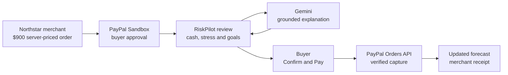

# RiskPilot

> **Your balance says yes. Rent says absolutely not.**

**Pre-payment financial intelligence for PayPal.** RiskPilot shows how a purchase could affect upcoming bills, cash reserves and savings goals before the buyer commits—then keeps the forecast consistent after a verified PayPal Sandbox capture.

`PayPal Sandbox` · `Google Gemini` · `Deterministic financial engine` · `324 automated tests` · `MIT`

## Why RiskPilot

Checkout answers whether a payment can go through. It rarely explains what that payment changes.

RiskPilot adds a decision layer between PayPal approval and capture:

- projects 45 days of dated cash flow;
- tests a one-week income delay;
- protects a user-defined cash buffer and savings goals;
- uses Gemini to explain verified engine facts; and
- leaves the final payment decision with the buyer.

The result is not another budgeting chatbot or an AI-controlled wallet. The financial engine owns the numbers, PayPal owns the payment lifecycle, and the user owns the decision.

## Demo at a glance

The primary demo follows fictional buyer **Alex** considering a **$900 laptop** at the independent Northstar merchant.

| Signal | Before purchase | Pay $900 now |
| --- | ---: | ---: |
| Checking cash | $3,500 | $2,600 projected starting cash |
| Lowest projected cash | $1,720 | $820 |
| Income one week late | $1,540 | $640 |
| Protected cash buffer | $1,000 | Crossed |
| Payment state | No order | Captured only after explicit confirmation |

These are deterministic results from fictional inputs pinned to **November 12, 2026**. They are not bank observations, credit decisions or financial advice.

## Core journey



Northstar uses PayPal `CONTINUE` with `commit:false`: approval creates no capture. RiskPilot verifies the order, amount, currency and current financial inputs before showing the review. Only **Confirm and Pay** requests capture.

RiskPilot Shop also supports a second flow: payment-free exploration followed by PayPal `PAY_NOW` with `commit:true`. The Northstar flow above is the recommended judging path.

## How it works

### Deterministic financial engine

TypeScript code calculates balances, dated income and expenses, cash-buffer risk, goal funding, purchase timing and educational installment comparisons. Immediate purchases reduce cash once; capture-time snapshots keep the assessed and recorded outcomes comparable.

### Grounded AI

RiskPilot uses **Google Gemini `gemini-3.6-flash`** through the `generateContent` API. The model selects and organizes approved fact identifiers; the application renders server-authored financial statements. Gemini can explain a result or draft a goal, but it cannot set balances, change calculations, choose a funding source or initiate payment.

Invalid output, provider errors and missing credentials fall back to clearly labeled deterministic explanations. Free-text questions require a configured Gemini key.

### PayPal integration

| PayPal capability | Role in RiskPilot |
| --- | --- |
| Sandbox Business and Personal accounts | Test seller and buyer without real funds |
| JavaScript SDK v6 | Buyer approval UI and eligible-method discovery |
| OAuth 2.0 | Server access tokens from Sandbox app credentials |
| Orders v2 API | Create, retrieve, verify and capture orders |
| Stable request/capture identifiers | Same-order recovery and duplicate-record protection |

The AI never receives PayPal credentials and has no payment tool. Client secrets, bridge keys and Gemini keys remain server-side.

## Architecture

**Next.js 15.5.29 · React 19.1.1 · TypeScript 5.8.3 · Node.js · Google Gemini API · PayPal JavaScript SDK v6 · PayPal Orders v2 · local JSON demo persistence**

```text
app/             Next.js UI and API routes
lib/             Forecasting, goals, AI contracts and payment safeguards
merchant-demo/   Independent Northstar merchant
tests/           Financial, AI, checkout and recovery regression tests
scripts/         Local launchers, readiness checks and credential helpers
docs/            Design, protocol, acceptance and demo documentation
```

The running prototype has no connected bank feed, brokerage, Supabase database or Python forecasting service.

## Judge quick start

### Prerequisites

- Node.js 22
- npm
- Git and Bash
- Python 3 and `curl`
- a free PayPal Sandbox REST app
- a separate PayPal Sandbox Personal buyer
- a Google Gemini API key

### 1. Install

```bash
git clone https://github.com/SuyaYang/RiskPilot.git
cd RiskPilot
npm ci
cp .env.example .env
```

Do not overwrite an existing `.env` or commit credentials.

### 2. Configure providers

Use the hidden-input helpers:

```bash
bash scripts/set-keys.sh paypal
bash scripts/set-keys.sh gemini
```

The PayPal Client ID and Secret must come from the same **Sandbox REST app** associated with a Sandbox Business seller. Use a separate **Personal Sandbox account** only inside PayPal's Sandbox buyer login.

The resulting `.env` must contain:

```dotenv
PAYPAL_CLIENT_ID=<sandbox-client-id>
PAYPAL_CLIENT_SECRET=<sandbox-client-secret>
NEXT_PUBLIC_PAYPAL_CLIENT_ID=<same-sandbox-client-id>
PAYPAL_API_BASE=https://api-m.sandbox.paypal.com

GEMINI_API_KEY=<gemini-api-key>
GEMINI_MODEL=gemini-3.6-flash
```

No webhook is required for the local capture flow.

### 3. Start

```bash
DEMO_TODAY=2026-11-12 npm run demo -- --no-open
```

Keep that terminal open. In a second terminal:

```bash
cd RiskPilot
npm run demo -- --check
```

| Service | URL |
| --- | --- |
| RiskPilot | http://localhost:3100 |
| Northstar merchant | http://localhost:3200 |

### 4. Test the end-to-end flow

1. Open RiskPilot in a fresh browser profile and select `alex@riskpilot.demo`; no password is required.
2. Open Northstar and select **Check out with PayPal Sandbox**.
3. Sign in with the Personal Sandbox buyer and choose **Continue / Review Order**.
4. Confirm that RiskPilot verifies the `$900 USD` order and shows approximately `$820` minimum cash and `$640` under delayed income.
5. Confirm that the explanation is labeled **AI · grounded facts**. Ask one purchase question if desired.
6. Expand **Compare buying now or after income**; the preview must not schedule or capture a payment.
7. Return to the current checkout and select **Confirm and Pay**.
8. Verify the PayPal Order ID, Capture ID, amount, completed status, saved before/after forecast and matching Northstar receipt.

If capture is pending or uncertain, recover the **same order** with **Check payment status** or **Refresh financial impact**. Do not create another order.

## Credential-free financial review

To inspect the deterministic product without provider checkout, leave PayPal and Gemini credentials blank and run:

```bash
DEMO_TODAY=2026-11-12 npm run dev
```

Open http://localhost:3000 and select `alex@riskpilot.demo`. Dashboard, Goals, Money, Shop analysis and deterministic explanation fallbacks remain available; no PayPal request is made.

## Validation

```bash
npm test
npm run typecheck
npm run build
git diff --check
```

Expected result: **324 tests pass**, TypeScript validation succeeds, the production build completes and no whitespace errors are reported. Tests use temporary stores and mocked providers; historical provider acceptance is documented separately.

## Trust boundaries

- All financial profiles and transactions are fictional.
- Pay Later schedules are educational estimates, not eligibility or loan terms.
- The final PayPal capture always requires a human action.
- Gemini cannot change financial truth or execute payments.
- Local JSON persistence is not a production ledger or authentication system.
- Public webhooks, real-bank reconciliation, refunds to bank balances and trading are outside the prototype.
- `/vision` is an illustrative future concept, not an official PayPal interface.

## Documentation

- [Complete running and troubleshooting guide](RUNNING.md)
- [Purchase state and confirmation flows](docs/PURCHASE_FLOWS.md)
- [Independent merchant integration](docs/MERCHANT_CHECKOUT.md)
- [Financial engine contract](docs/FORECAST_INTEGRATION.md)
- [Implementation status](docs/IMPLEMENTATION_STATUS.md)
- [Three-minute demo rehearsal](docs/STEP7B_DEMO_REHEARSAL.md)
- [Sanitized Sandbox acceptance record](docs/STEP7B_ACCEPTANCE.md)

## Team and license

Built by the RiskPilot team. Sheryl's [baseline MVP](https://github.com/SuyaYang/RiskPilot/commit/3d1543e) established the initial engine and checkout foundation; subsequent team contributions extended the product, safeguards and verification. Git history preserves attribution.

Licensed under the [MIT License](LICENSE). The bundled Inter font uses the [SIL Open Font License](app/fonts/OFL.txt).
