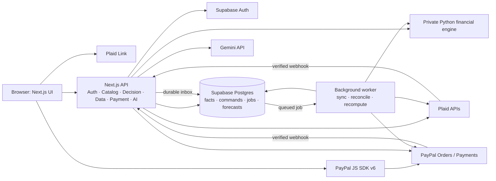

# Original architecture roadmap (historical reference)

Preserved from Sheryl’s baseline README at [`3d1543e`](https://github.com/SuyaYang/RiskPilot/commit/3d1543e).
This is a **proposed architecture and contract**, not a statement that every service, route or acceptance gate is implemented.
In particular, Supabase authentication/Postgres, the Python engine service, background worker, Plaid connection/reconciliation and public deployment are unfinished.
The running demo uses Next.js, the TypeScript engine and local JSON ledgers.

See the [current README](../README.md) for implemented features, the two current payment flows, setup and verification limits.
Checkout descriptions and test counts in older documents must be read in their historical context.

---

## 1. Architecture



The Web API is **one TypeScript application** with internal modules; the diagram does not imply a microservice per adapter. The only separate compute service is the deterministic Python engine. A Postgres-backed job table is sufficient initially; add a queue broker only if measured load requires one.

| Component | Responsibility | Boundary |
|---|---|---|
| Browser / Next.js UI | Onboarding, goals, store, comparisons, checkout, order status | Sends user intent; never supplies authoritative prices or payment status |
| Next.js API | Session/ownership checks, server catalog, decision orchestration, provider adapters, webhook intake | Owns commands and external credentials; calls the engine for numbers |
| Python engine | Daily cash flow, stress cases, goal allocation, risk, allocatable cash | Pure versioned input → output; no database writes or provider secrets |
| Worker | Per-Item Plaid sync, payment reconciliation, versioned recomputation, reminders | Replays durable jobs; only owner of sync cursors |
| Supabase Auth / Postgres | Identity, RLS, immutable provider facts, commands, snapshots, jobs, projections | Source of record; service-secret queries enforce `user_id` themselves |
| PayPal | Buyer approval, merchant order/capture, payment events | Capture proves merchant payment, not the consumer's funding account |
| Plaid | User-authorized account balances and transactions | Read-only financial observation; Sandbox transaction injection is test-only |
| Gemini adapter | Goal drafting, constrained read/simulation tools, fact-checked explanation | Cannot calculate final balances, set prices, execute capture, or run arbitrary SQL |

**Proposed repository layout**

```text
apps/web/               Next.js UI, API routes, provider adapters
apps/worker/            durable jobs, sync, reconciliation, reminders
services/engine/        Python cash-flow kernel and private HTTP wrapper
packages/contracts/    versioned JSON Schema/OpenAPI and generated types
packages/domain/       money, date, state, and idempotency rules
supabase/migrations/   tables, RLS, indexes, uniqueness constraints
fixtures/              resettable demo users, accounts, transactions, catalog
tests/                 financial invariants, payment failures, tenant isolation
docs/                  detailed design, source audit, demo instructions
render.yaml            deployment declaration after service setup is tested
```

## 2. Data and payment contract

| Layer | Examples | Rule |
|---|---|---|
| Observed | Plaid balance or transaction | Keep source and `observed_at`; do not overwrite with a forecast |
| Committed | Verified PayPal capture, bill, user-confirmed installment | Count each economic obligation once |
| Predicted | Daily balance, goal date, risk, allocatable cash | Derive from a versioned snapshot; never present as a bank balance |

Core persisted entities: `profiles`, `plaid_items`, `accounts`, `transactions`, `balance_snapshots`, `scheduled_events`, `goals`, `products`, `carts`, `financial_snapshots`, `forecasts`, `decisions`, `checkout_sessions`, `order_commands`, `orders`, `captures`, `webhook_inbox`, `cashflow_commitments`, `installment_plans`, `reconciliation_links`, `jobs`, and `audit_log`. Provider IDs have unique constraints in their proper merchant/Item scope; user-editable records carry versions.

1. **Assess.** The API prices the cart from its own catalog and freezes user, cart/goal/snapshot/policy versions, currency, and selected option. The engine returns comparable scenarios, lowest projected cash, goal delay, risk, and fact IDs. A stale input requires reassessment.
2. **Create.** The API creates a PayPal order for the **full cart amount**. A $900 item stays a $900 merchant order even if the buyer chooses Pay Later; a $600 alternative is a different product/order. The browser starts an eligible PayPal SDK session.
3. **Capture.** Buyer approval returns to a RiskPilot purchase-impact overview. Only an explicit final `Make payment` confirmation with the current input hash starts capture. The API verifies ownership and the frozen order, then captures with a stable `PayPal-Request-Id`. Browser `onApprove` alone is not payment proof. Persist the capture fact, conservative unallocated consumer commitment, and recompute job in one database transaction.
4. **Recover.** Record the order and capture command before the provider call. If the call times out or PayPal succeeds while the local write fails, mark the command `UNKNOWN` and recover through provider lookup or a verified webhook. Never retry with a new idempotency key.
5. **Reconcile.** The worker applies Plaid added/modified/removed transactions once per Item cursor, matches observed debits to commitments, and resolves only the matched amount. Ambiguous funding requires customer confirmation. PayPal Sandbox does not automatically alter Plaid Sandbox balances.

The forecast protects cash needed for future bills and goals. It checks the visible 45-day horizon **and all evaluated installment dates**. Missing data or unknown loan terms yield `UNKNOWN`, not a safe verdict. “Available to allocate today” means cash removable today without violating covered future obligations, buffers, or protected goals. [PayPal Orders](https://developer.paypal.com/api/orders/v2/), [Pay Later](https://developer.paypal.com/pay-later/overview), [Plaid Transactions](https://plaid.com/docs/api/products/transactions/)

## 3. Internal APIs

These are **RiskPilot routes**, not vendor endpoints. Except webhooks and health checks, each requires an authenticated session; the server derives `user_id`. Writes use expected versions and, where repeatable, scoped idempotency keys. Sensitive responses use `Cache-Control: no-store`.

| Area | Routes | Contract |
|---|---|---|
| Bank connection | `POST /api/bank/link-token`; `POST /api/bank/exchange`; `DELETE /api/bank/connections/{id}` | Create Link token, exchange public token, disconnect owned Item |
| Accounts/profile | `GET /api/accounts`; `PATCH /api/accounts/{id}`; `PUT /api/financial-profile` | Account purposes or manual balances, bills, income, timezone, buffer |
| Dashboard/sync | `GET /api/dashboard`; `POST /api/refresh`; `GET /api/jobs/{id}` | Timestamped data/forecast; asynchronous refresh status |
| Goals | `GET /api/goals`; `POST /api/goals/parse`; `POST /api/goals`; `PATCH /api/goals/{id}`; `DELETE /api/goals/{id}` | AI draft requires user confirmation; edits version and recompute |
| Catalog/cart | `GET /api/products`; `POST /api/carts`; `PATCH /api/carts/{id}` | Server catalog and total; client sends SKU/quantity, never price |
| Decisions | `POST /api/decisions`; `GET /api/decisions/{id}`; `POST /api/decisions/{id}/select` | Versioned option/risk/fact IDs; selection creates checkout session |
| Checkout | `POST /api/paypal/orders`; `POST /api/paypal/orders/{id}/capture`; `GET /api/orders/{id}` | Frozen amount; capture request has no amount field; separate payment/projection/funding statuses |
| Merchant handoff | `POST /api/merchant/claim` | Verify an expiring integrated-merchant link; bind its server-verified order to the current demo workspace. Existing capture route sends merchant orders through the signed merchant bridge. |
| Funding | `PUT /api/orders/{id}/funding-plan` | User-confirmed source and dated schedule; never inferred from merchant capture |
| Investment | `GET /api/investment-capacity`; `PUT /api/investment-preferences` | Educational cash limit and assumptions; no trade execution |
| Notifications/privacy | `GET /api/notifications`; `PATCH /api/notifications/{id}`; `DELETE /api/me/data` | Read status; deletion requires reauthentication and retention handling |
| Inbound/ops | `POST /api/webhooks/paypal`; `POST /api/webhooks/plaid`; `GET /api/health` | Verify raw event, persist inbox, then acknowledge; health exposes no secrets |
| Demo-only | `POST /api/demo/reset` | Authorized reset of one demo user's scenario; absent in production |

The private engine exposes `POST /v1/forecast`, `POST /v1/allocate-goals`, `POST /v1/evaluate-purchase`, and `POST /v1/investment-capacity`. All accept `schema_version`, `policy_version`, `as_of`, timezone, currency, and an input hash; money uses integer minor units. The latter three reuse one cash-flow kernel. Errors include stable `code`, `retryable`, and `trace_id`. [Implementation and contract gaps](IMPLEMENTATION_STATUS.md)

## 4. External APIs and SDKs

**Core** means required for the purchase demo. **Bank** is required when automatic Plaid connection is enabled; a manual profile remains possible. **Conditional** calls support an enabled feature or recovery. All REST calls below are server-side unless marked browser SDK.

| Provider | Exact endpoint or SDK method | Used for | Scope |
|---|---|---|---|
| PayPal | `POST /v1/oauth2/token` | Merchant access token | Core |
| PayPal | `POST /v2/checkout/orders` | Full-price order | Core |
| PayPal | `GET /v2/checkout/orders/{id}` | Validate/recover order | Core |
| PayPal | `POST /v2/checkout/orders/{id}/capture` | Capture approved order | Core |
| PayPal | `GET /v2/payments/captures/{id}` | Confirm capture/recovery | Core recovery |
| PayPal | `POST /v1/notifications/verify-webhook-signature` | Verify inbound PayPal event | Core |
| PayPal | `POST /v1/notifications/webhooks` or Dashboard | Register HTTPS listener/event types | One-time setup |
| PayPal JS SDK v6 | `createInstance({ clientId })`; `findEligibleMethods()` | Initialize buyer checkout and eligibility | Browser/core |
| PayPal JS SDK v6 | `createPayPalOneTimePaymentSession()` | Standard buyer approval | Browser/core |
| PayPal JS SDK v6 | `createPayLaterOneTimePaymentSession()` | Pay Later approval when eligible | Browser/conditional |
| Plaid Link | Link token + `onSuccess(public_token)` | User-authorized bank connection | Browser/bank |
| Plaid | `POST /link/token/create`; `POST /item/public_token/exchange` | Start Link; store encrypted Item token | Bank |
| Plaid | `POST /accounts/balance/get`; `POST /transactions/sync` | Dated balance; incremental transactions | Bank |
| Plaid | `POST /webhook_verification_key/get`; `POST /item/remove` | Verify webhook JWT; disconnect Item | Bank |
| Gemini | `POST /v1beta/models/{model}:generateContent` or SDK equivalent | Parse goals and explain engine facts via constrained tools | Core AI |
| Supabase | Auth SDK `signInWithPassword`, `signOut`, `getClaims`/`getUser`; Postgres SQL/RLS | Identity, session, durable records | Core |
| PayPal | `POST /v2/payments/captures/{id}/refund`; `GET /v2/payments/refunds/{id}` | Merchant refund and status, if built | Conditional |
| Plaid | `POST /accounts/get`; `POST /transactions/recurring/get`; `POST /transactions/refresh` | Cached metadata, recurring hints, explicit refresh | Conditional |
| Plaid Sandbox | `POST /sandbox/public_token/create`; `POST /sandbox/transactions/create`; `POST /sandbox/item/fire_webhook` | Repeatable test Items, later bank debit, webhook tests | Test only |

PayPal Sandbox REST base: `https://api-m.sandbox.paypal.com`. Plaid Sandbox base: `https://sandbox.plaid.com`. Subscribe to `PAYMENT.CAPTURE.COMPLETED`, `PAYMENT.CAPTURE.PENDING`, `PAYMENT.CAPTURE.DECLINED`, `PAYMENT.CAPTURE.REFUNDED`, and `PAYMENT.CAPTURE.REVERSED`. Plaid webhook intake triggers cursor sync; the webhook itself is not treated as a transaction ledger. [PayPal REST](https://developer.paypal.com/api/rest/), [Orders](https://developer.paypal.com/api/orders/v2/), [Payments](https://developer.paypal.com/api/payments/v2/), [JS SDK v6](https://developer.paypal.com/sdk/js/set-up), [Webhook events](https://developer.paypal.com/api/rest/webhooks/event-names), [Plaid Link](https://plaid.com/docs/api/link/), [Transactions](https://plaid.com/docs/api/products/transactions/), [Webhook verification](https://plaid.com/docs/api/webhooks/webhook-verification/), [Gemini generateContent](https://aistudio.google.com/api-reference/generate-content)

PayPal Agent Toolkit, MCP Server, Postman, and Webhook Simulator are **development aids**, not extra runtime dependencies. The payment adapter calls Orders/Payments directly so amount, ownership, and idempotency remain enforced by application code. The v6 setup documentation contains conflicting client-ID/client-token examples; choose one path only after a real Sandbox smoke test. [Toolkit](https://developer.paypal.com/ai-tools/toolkit/), [MCP Server](https://developer.paypal.com/ai-tools/mcp-server), [Postman](https://www.postman.com/paypal)

## 5. Environments, deployment, and credentials

| Environment | Web / engine / worker | Data and providers | Purpose |
|---|---|---|---|
| Local | Local processes; Web `:3000`, engine `:8000` | Isolated dev database; PayPal/Plaid Sandbox; fixed AI fixtures by default | Fast development, no production data |
| CI | Temporary processes and database | Deterministic provider/AI fixtures | Contract, finance, idempotency, and isolation tests |
| Staging | Separate Render services | Separate Supabase project and Sandbox credentials | Real provider smoke tests and migrations |
| Demo | Pinned Render release | Separate demo database, Sandbox merchant/buyer, controlled AI budget | Public judging and resettable scenarios |
| Production later | Independently provisioned | Live credentials, backups, access review | Out of hackathon scope |

Deploy Next.js as a **Render Web Service** (server API requires Node), the engine as a **Render Private Service**, and the job runner as a **Render Background Worker**. Supabase hosts Auth and Postgres. Use a GitHub repository for versioned source, CI, an open-source license, and the hackathon submission. Do not deploy from an untested local-only copy. [Render Next.js](https://render.com/docs/deploy-nextjs-app), [Private services](https://render.com/docs/private-services), [Background workers](https://render.com/docs/background-workers), [Hackathon rules](https://paypalaihackathon.devpost.com/rules)

**Environment variable contract** (names only; values belong in local secrets or Render/Supabase configuration):

```dotenv
APP_ENV=local
APP_ORIGIN=http://localhost:3000
NEXT_PUBLIC_SUPABASE_URL=
NEXT_PUBLIC_SUPABASE_PUBLISHABLE_KEY=
DATABASE_URL=
SUPABASE_SERVER_SECRET_KEY=
NEXT_PUBLIC_PAYPAL_CLIENT_ID=
PAYPAL_CLIENT_ID=
PAYPAL_CLIENT_SECRET=
PAYPAL_API_BASE=https://api-m.sandbox.paypal.com
PAYPAL_WEBHOOK_ID=
PLAID_CLIENT_ID=
PLAID_SECRET=
PLAID_API_BASE=https://sandbox.plaid.com
PLAID_WEBHOOK_URL=
GEMINI_API_KEY=
GEMINI_MODEL=
ENGINE_BASE_URL=http://localhost:8000
ENGINE_SERVICE_TOKEN=
DATA_ENCRYPTION_KEY=
FORECAST_POLICY_VERSION=rp-v1
DEMO_SEED_ENABLED=true
```

Only `NEXT_PUBLIC_*` variables may enter the browser. The PayPal browser and server client IDs must belong to the same Sandbox app. OAuth tokens, Plaid Item tokens, merchant/Plaid/Gemini secrets, database server keys, and the engine service token stay server-side; encrypt stored Plaid access tokens. Supabase service-secret queries bypass RLS, so every such order, forecast, and Item operation must enforce user ownership. [Supabase keys](https://supabase.com/docs/guides/getting-started/api-keys), [RLS](https://supabase.com/docs/guides/database/postgres/row-level-security)

| Service | Official site to obtain/configure access | Needed |
|---|---|---|
| PayPal | [Developer Dashboard → Apps & Credentials / Sandbox Accounts](https://developer.paypal.com/dashboard/) | Sandbox app client ID/secret, business merchant, personal buyer, webhook ID |
| Plaid | [Plaid Dashboard → Team → Keys](https://dashboard.plaid.com/) | Client ID, Sandbox secret, test institution/user and Item |
| Gemini | [Google AI Studio API keys](https://aistudio.google.com/apikey) | Server API key and an available model |
| Supabase | [Supabase Dashboard](https://supabase.com/dashboard) | Project URL, publishable/server keys, Postgres connection |
| Render | [Render Dashboard](https://dashboard.render.com/) | Web/private/worker services and secret settings; no runtime API key |
| GitHub | [GitHub](https://github.com/) | Public repository, license, CI; no app runtime API key |

## 6. Acceptance gates

- A real Sandbox buyer completes create → approve → capture for the server-priced cart; the verified capture changes a versioned forecast.
- Pay Later is shown as an actual buyer choice only when eligible; any pre-checkout payment schedule remains labeled hypothetical until its terms are confirmed.
- Repeated/out-of-order webhooks, capture timeouts, a failed local write after capture, and a later Plaid debit cannot double-charge or double-count the obligation.
- User A cannot read or change user B's bank Items, goals, decisions, orders, or forecasts; server-secret paths are included in this test.
- Financial numbers come from the deterministic engine; AI explanations show only current verified facts and fall back to templates when unavailable.
- The demo has tested startup/reset instructions, migrations, `.env.example`, a license, and a public video/repository before submission.

Implementation details and verification: [acceptance status](IMPLEMENTATION_STATUS.md) · [local demo instructions](../RUNNING.md).
